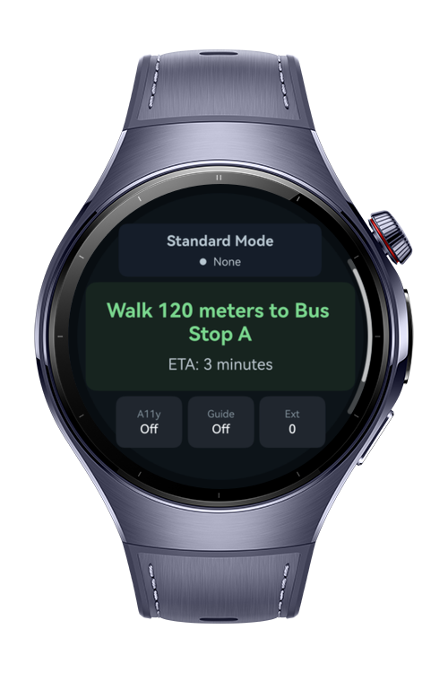
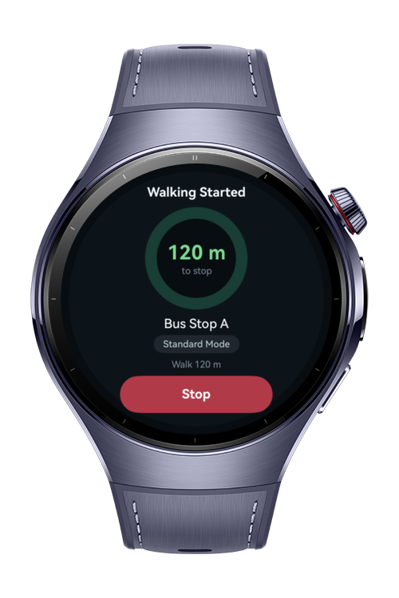

> **Note:** To access all shared projects, get information about environment setup, and view other guides, please visit [Explore-In-HMOS Index](https://github.com/Explore-In-HMOS/hmos-index).

# How To Audit Accessibility State

Accessible Transit Start is a HarmonyOS wearable sample built with ArkTS and ArkUI. The app checks the current AccessibilityKit state before a rider starts a mock walk to a bus stop, then selects the safest start mode for the watch experience.

# Preview

<div>
  
  
</div>

# Use Cases

- Check whether accessibility is enabled before starting a wearable transit flow
- Detect touch guide and double-touch mode for a safer watch interaction
- Query enabled accessibility extensions and show a compact count
- Provide a circular-screen friendly route start screen using `ArcList`
- Profile AccessibilityKit calls from device logs while testing runtime support

- **Route Start**: circular `ArcList` layout with mode, route, ETA, accessibility chips, extension count, Start Walking, and Refresh Status.
- **Walking Started**: centered round guidance screen with remaining distance, current route instruction, active mode, and Stop action.
- **Logger Profiling**: each accessibility status refresh logs API result, fallback behavior, and call duration with the `TransitA11yStatus` tag.

Work Conditions
- The app is designed for HarmonyOS wearable devices with round screens.
- The sample uses a mock route only. It does not use GPS, maps, bus APIs, or live navigation.
- `isOpenAccessibilitySync()` and `isOpenTouchGuideSync()` are expected to work on supported wearable runtimes.
- `getTouchModeSync()` requires runtime support. If it is unavailable, the app logs the condition and uses `Fallback Mode`.
- `getAccessibilityExtensionListSync()` requires runtime support for extension queries. If the runtime rejects the query, the app logs the fallback and shows `0` extensions.
- When accessibility and touch guide are off and touch mode is `none`, the expected mode is `Standard Mode`.
- When accessibility or touch guide is enabled, the expected mode is `Accessible Mode`.
- When touch mode is `doubleTouchMode`, the expected mode is `Double-Touch Mode`, which has the highest priority.
- Logs can be filtered with `TransitA11yStatus` to inspect API results, durations, and fallback behavior.

# Technology

## Stack

- **Languages**: ArkTS, ArkUI
- **Frameworks**: HarmonyOS Stage Model
- **Tools**: DevEco Studio, Hvigor
- **Libraries**:
	- `@kit.AccessibilityKit`
	- `@kit.ArkUI`
	- `@kit.PerformanceAnalysisKit`
	- `@ohos.app.ability.UIAbility`

## Required Permissions

- No special app permissions are required.
- Accessibility state is queried through AccessibilityKit read APIs.

# Directory Structure

```
entry/
|   src/
|       main/
|       |   module.json5
|       |
|       |---ets
|       |   |---entryability
|       |   |       EntryAbility.ets
|       |   |
|       |   |---entrybackupability
|       |   |       EntryBackupAbility.ets
|       |   |
|       |   |---pages
|       |   |       Index.ets
|       |   |
|       |   |---services
|       |           AccessibilityStatusService.ets
|       |
|       |---resources
|               base/
|               dark/
|
|       test/
|           LocalUnit.test.ets
```

# Constraints and Restrictions

## Supported Device

- Huawei Watch 5
- HarmonyOS smart wearables
- Round-screen wearable layouts are the primary target
- `getTouchModeSync()` and `getAccessibilityExtensionListSync()` depend on runtime support. If unavailable, the app logs the fallback and continues safely.

# License

**How to Audit Accessibility State** is distributed under the terms of the MIT License. See the [LICENSE](LICENSE) for more information
